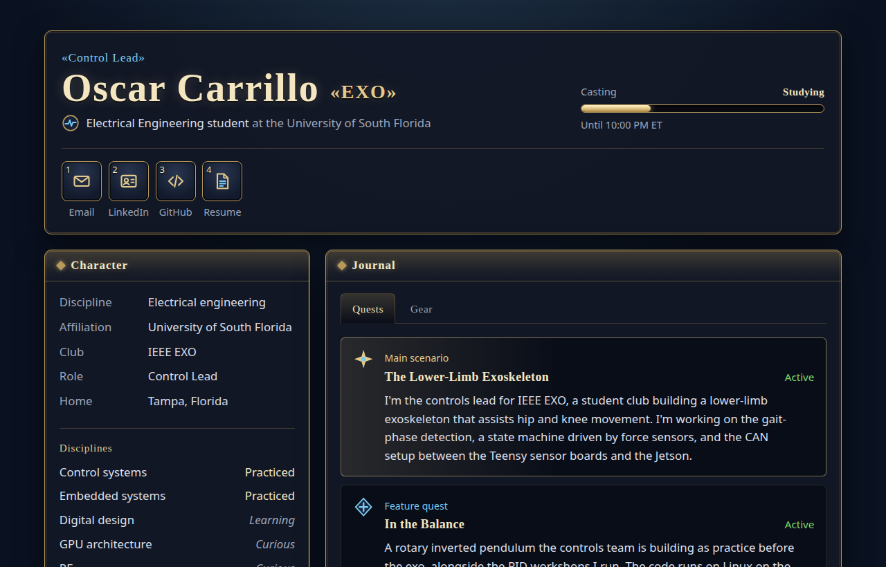

# oscarc727.github.io

My personal website, live at **[oscarc727.github.io](https://oscarc727.github.io)**.

It's styled like an MMO character sheet: projects are a quest journal and skills are a gear screen.

## What's on it

- **Quests:** my projects, each linking to its repo
- **Gear:** my skills (programming, tools, and hardware)
- **Resume:** a PDF copy of my resume
- **Orchestrion:** what I'm listening to on Spotify, from my [widget fork](https://github.com/OscarC727/novatorem)

## How it's built

One `index.html` with no frameworks or build step. GitHub Pages serves it straight from this repo.
